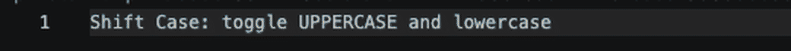

# Shift Case

**One key, two states, nothing to configure.** Press `Shift+Alt+U` to flip text between UPPERCASE and lowercase.

- All-uppercase text → lowercase
- Everything else (lowercase or mixed case) → UPPERCASE

## Why Shift Case?

- **Predictable.** It never cycles through other cases: it only flips between UPPERCASE and lowercase. Mixed-case text becomes UPPERCASE and then lowercase, so use undo to get the original mixed case back.
- **Zero config.** No settings, no case menu, no mode to remember. Install it and press the key.
- **Multi-cursor aware.** Works with multiple cursors and selections, and one undo reverts them all.
- **Lightweight.** No runtime dependencies, no telemetry and no network access. It only loads when you run one of its commands, and the whole package is about 14 KB.
- **Works everywhere.** Desktop VS Code, plus VS Code for the Web (vscode.dev, github.dev).

## Usage

1. Select the text you want to change, or just put the cursor in a word.
2. Press `Shift+Alt+U`, or run **Toggle Case** from the Command Palette.

With no selection, the word under the cursor is toggled (using the language's own definition of a word) and left selected, so a second press flips it to the other case (for all-lowercase or all-uppercase text that restores the original).

## More cases (optional)

The toggle stays a simple two-state switch. If you also want other cases, these are separate commands in the Command Palette, with **no default keybinding**:

| Command | Example |
| --- | --- |
| **Shift Case: Snake Case** | `Hello World` → `hello_world` |
| **Shift Case: Pascal Case** | `hello world` → `HelloWorld` |
| **Shift Case: Sentence Case** | `HELLO THERE. BYE` → `Hello there. Bye` |

They act on the selection (or the word under the cursor) just like the toggle. To bind one, open **Preferences: Open Keyboard Shortcuts** and search for `shift-case`.

VS Code's built-in Transform commands (below) already cover Snake and Pascal Case in recent versions, so use whichever you prefer; Sentence Case is the one the built-ins don't offer.

## Shift Case vs. the built-in Transform commands

VS Code ships **Transform to Uppercase** and **Transform to Lowercase** in the Command Palette (recent versions add more, such as Title, Snake, Camel, Pascal and Kebab Case). They have no default keyboard shortcut, and each goes one way only: to flip back you run the other command. Shift Case is a single shortcut that goes whichever way is needed, so you never have to decide first.

If you need many case styles, the built-in commands or a multi-case extension are a better fit. Shift Case is for the case where you just want to flip upper/lower with one key.

## Extension Settings

None. This extension has no configurable settings.

## Release Notes

See the [changelog](https://github.com/BitByAndy/shift_case/blob/main/shift-case/CHANGELOG.md).
