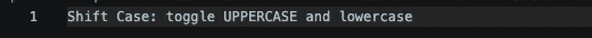

# Shift Case

A VS Code extension that toggles selected text between UPPERCASE and lowercase.

## Features

Press `Shift+Alt+U` (or run **Toggle Case** from the Command Palette) to switch between cases. Select text first, or just put the cursor in a word and the word is toggled and selected.

- All-uppercase text → lowercase
- Everything else (lowercase or mixed case) → UPPERCASE
- Works with multiple cursors / multiple selections; one undo reverts them all
- With no selection, toggles the word under the cursor (using the language's own definition of a word)

## Usage

1. Select the text you want to change, or place the cursor in a word
2. Press `Shift+Alt+U` — or open the Command Palette and run **Toggle Case**

## Extension Settings

This extension has no configurable settings.

## Release Notes

### 0.0.2

Declared the activation event explicitly and added a demo GIF to the README.

### 0.0.1

Initial release — toggle case command with keybinding and multi-cursor support.
